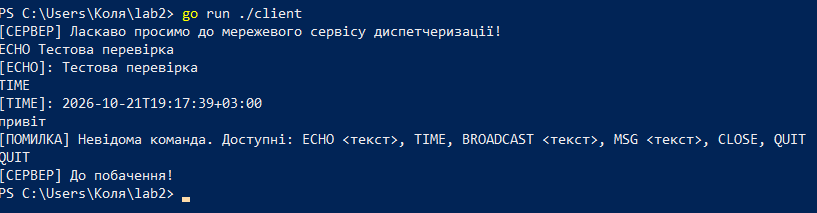
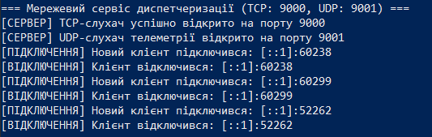
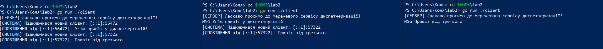
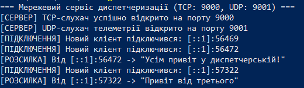
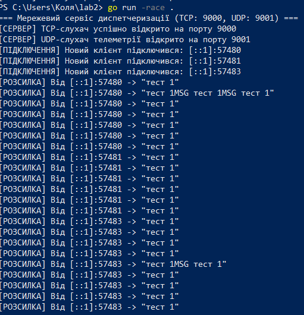
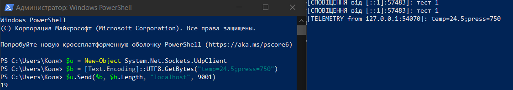
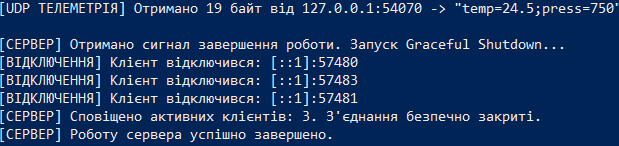

# Практична робота № 2

**Тема:** Сокетне програмування та обмін повідомленнями по TCP/UDP

Консольний мережевий сервіс диспетчеризації та телеметрії (Device & Dispatcher Gateway) на Go. Сервер одночасно обслуговує TCP-клієнтів, приймає UDP-датаграми з телеметрією і розсилає події всім підключеним клієнтам.

## Структура проєкту

```
lab2/
├── main.go          # сервер
├── client/
│   └── main.go      # тестовий TCP-клієнт
├── go.mod
├── screens/         # скриншоти
└── README.md
```

## Вимоги

- Go 1.22 або новіше
- Windows, macOS або Linux

## Запуск

Сервер (TCP на порту 9000, UDP на порту 9001):

```
go run .
```

Сервер з перевіркою на стан гонитви:

```
go run -race .
```

Тестовий клієнт (у окремому терміналі, можна запускати кілька):

```
go run ./client
```

Також можна підключатись через `nc localhost 9000` або `telnet localhost 9000`.

## Команди протоколу

Повідомлення розділяються символом нового рядка (`\n`).

| Команда | Дія |
|---|---|
| `ECHO <текст>` | повертає текст з префіксом `[ECHO]:` |
| `TIME` | повертає поточний час сервера (RFC3339) |
| `BROADCAST <текст>` або `MSG <текст>` | надсилає текст усім іншим клієнтам |
| `CLOSE` або `QUIT` | закриває з'єднання |

На невідому команду сервер відповідає помилкою зі списком доступних команд.

## Реалізація

**Рівень 1.** TCP-сервер на `net.Listen`. Для кожного підключення в циклі `Accept()` запускається окрема горутина. Рядки читаються через `bufio.NewReader` і `ReadString('\n')`, очищаються `strings.TrimSpace`.

**Рівень 2.** Підключені клієнти зберігаються в `map`, яка захищена `sync.Mutex`. Клієнт видаляється з `map` через `defer`. Розсилка проходить по `map` під блокуванням. Усі учасники отримують системні сповіщення про підключення та відключення клієнтів.

**Рівень 3.** UDP-сокет `net.ListenPacket("udp", ":9001")` слухається в окремій горутині. Отримані датаграми розсилаються всім TCP-клієнтам у форматі `[TELEMETRY from <адреса>]: <дані>`. Для Graceful Shutdown перехоплюються `os.Interrupt` і `SIGTERM`: сервер розсилає `SERVER_SHUTTING_DOWN`, закриває слухачі та з'єднання і чекає завершення горутин через `sync.WaitGroup`.

## Результати роботи

### Рівень 1. TCP-сервер команд

Клієнт: команди `ECHO`, `TIME`, невідома команда, `QUIT`.



Сервер: підключення і відключення клієнтів.



### Рівень 2. Реєстрація клієнтів і розсилка

Три клієнти обмінюються повідомленнями командою `MSG`.



Консоль сервера.



Запуск з `go run -race .` і масова розсилка повідомлень. Попереджень `DATA RACE` немає.



### Рівень 3. UDP-телеметрія і Graceful Shutdown

Відправка UDP-датаграми на порт 9001 і її отримання TCP-клієнтом.

```powershell
$u = New-Object System.Net.Sockets.UdpClient
$b = [Text.Encoding]::UTF8.GetBytes("temp=24.5;press=750")
$u.Send($b, $b.Length, "localhost", 9001)
```



Graceful Shutdown після натискання Ctrl+C: клієнти сповіщені, з'єднання закриті, сервер завершив роботу.


